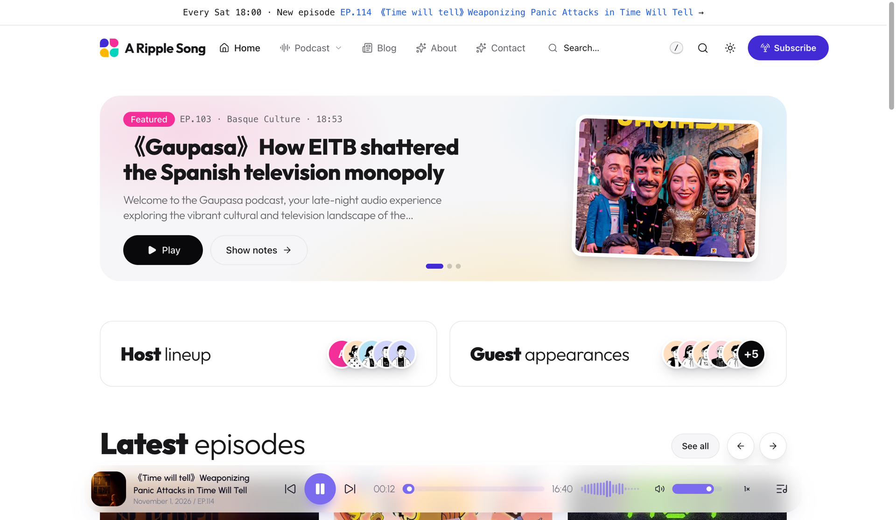
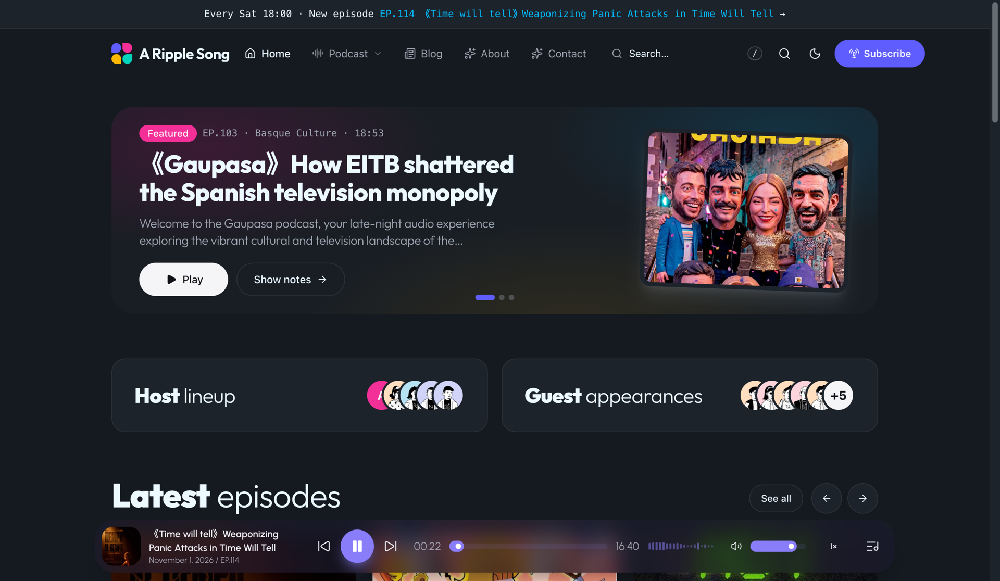
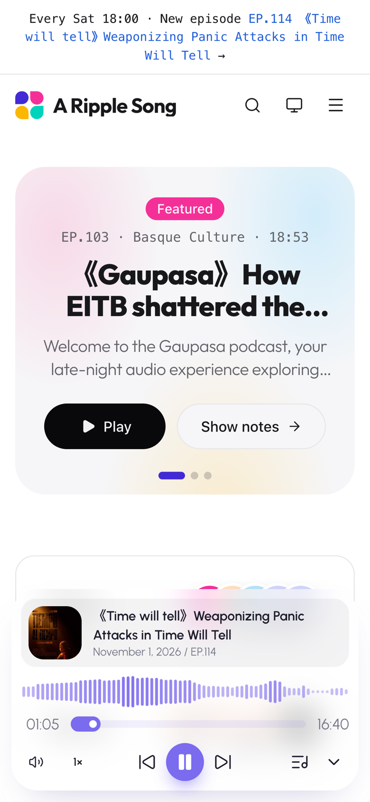

# ARS Petal

English | [简体中文](README.zh.md)

A bright, component-library style WordPress podcast theme: lots of white space, bold / light mixed headlines, colorful blocks with soft glows, and a blue-gray night mode. Pair it with the [A Ripple Song](https://github.com/jiejia/a-ripple-song) plugin for a full podcast site, or use it on its own as a clean blog theme.

<table>
  <tr>
    <td colspan="2"></td>
  </tr>
  <tr>
    <td width="70%"></td>
    <td width="30%"></td>
  </tr>
</table>

Live demo: [podcast.aripplesong.com](https://podcast.aripplesong.com/)

## Features

The plugin owns the podcast data, RSS feed and site-wide player; the theme handles how it all looks.

- **Landing page**: a page template built from the `Home Top` widget area, with widgets for a featured / latest carousel, hosts and guests, episode rails and lists, stats and topic cards.
- **Episodes**: an archive with topic sidebar, sorting and list / grid views; episode pages with play, share, like and download actions plus Summary / Chapters / Transcript tabs.
- **Uninterrupted playback**: Swup page transitions keep the player running, and cards show the "now playing" state.
- **Color modes**: light, dark or follow system, with a visitor toggle.
- **Navigation**: header / footer menus, mega dropdowns, a mobile drawer, and Lucide menu icons via an `icon-{name}` class.
- **Extras**: image or bundled-icon logo, search dialog, announcement bar, subscribe section.
- **Translation-ready**, with English and Simplified Chinese included.

## Installation

Requires WordPress 6.6+ and PHP 8.2+.

1. Download `ars-petal.zip` from the latest [release](https://github.com/jiejia/ars-petal/releases) and upload it under `Appearance > Themes > Add New > Upload Theme`, then activate it.
2. Optional: install and activate [A Ripple Song](https://github.com/jiejia/a-ripple-song). The matching `ars-petal` player skin is selected automatically.
3. To use the landing page as your home page, click `Create and set as homepage` in the notice shown after activation (or create a page with the `Landing page` template and set it as the static homepage under `Settings > Reading`).
4. Arrange the landing page under `Appearance > Widgets > Home Top` (default sections show while it is empty), and set the color scheme and footer text under `Appearance > Customize > Petal`.

## Development

```bash
npm install
npm run build              # build icons, CSS and JS into public/dist
npm run watch:css          # or watch:js
npm run i18n               # regenerate translations (requires WP-CLI)
npm run package            # build build/ars-petal.zip
npm run release X.Y.Z      # bump, commit, tag and push; GitHub Actions publishes the release
```

Built with [Tailwind CSS](https://tailwindcss.com/), [daisyUI](https://daisyui.com/), [Alpine.js](https://alpinejs.dev/), [Swup](https://swup.js.org/), [esbuild](https://esbuild.github.io/) and [Lucide](https://lucide.dev/).

| Path | Contents |
| --- | --- |
| `app/` | Theme logic: setup, assets, Customizer, navigation, widgets, A Ripple Song integration |
| `resources/templates/` | PHP templates: layouts, home sections, cards, partials, episode views |
| `resources/assets/` | CSS, JS, icons, images |
| `resources/lang/` | Translation files |
| `bin/` | Build, package, i18n and release scripts |

## License

[GPL-3.0](LICENSE) · Website: [aripplesong.com](https://aripplesong.com/)
