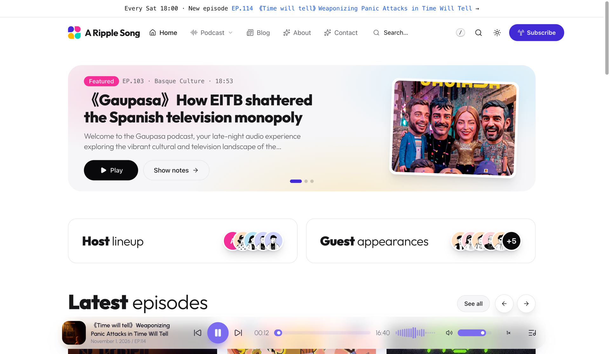
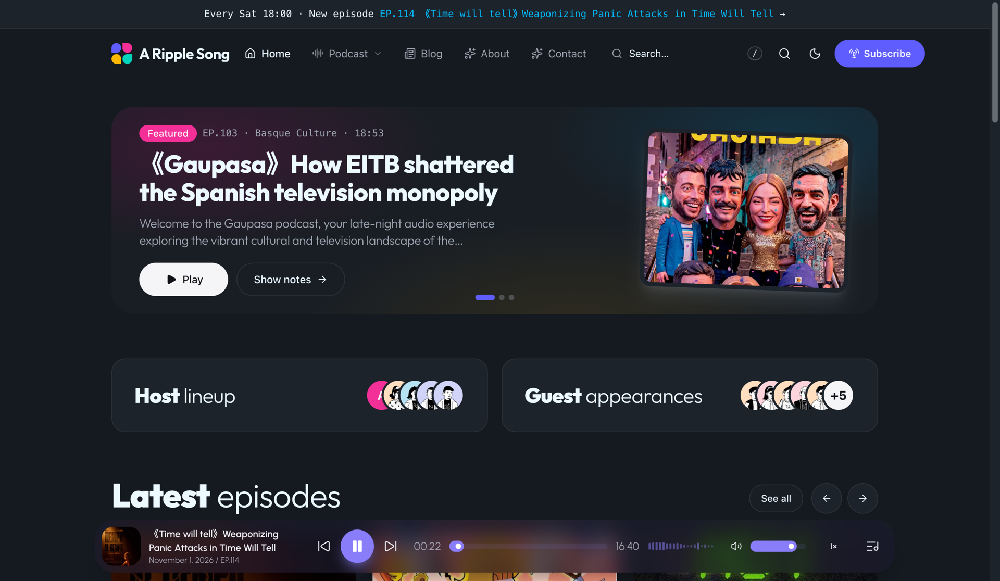
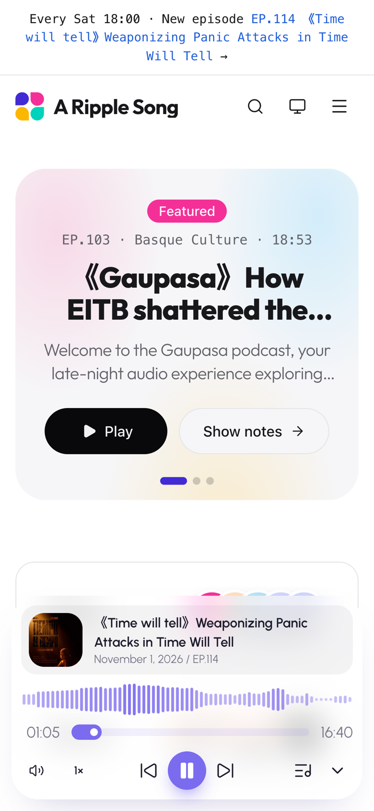

# ARS Petal

ARS Petal 是一款明亮的组件库风格 WordPress 播客主题：大量留白、粗细混排的大标题、靛蓝 / 洋红 / 青绿 / 明黄色块与柔和光晕，并带有蓝灰色夜间模式。搭配 [A Ripple Song](https://github.com/jiejia/a-ripple-song) 插件即可成为完整的播客站点；不启用插件时，它是一款简洁的博客主题。



<table>
  <tr>
    <td width="70%"></td>
    <td width="30%"></td>
  </tr>
</table>

在线演示：[podcast.aripplesong.com](https://podcast.aripplesong.com/)

## 概览

ARS Petal 采用清晰的分工：A Ripple Song 插件负责播客数据、RSS Feed 和全站播放器，主题负责呈现效果。主题从插件读取节目、播客分类、主播、嘉宾、章节和文字稿，组织成播客首页、节目归档页和节目详情页。站内跳转使用页面过渡，浏览时播放不会中断。

## 功能特性

- `Landing page`（落地页）页面模板由 `Home Top` 小工具区域构建，内置小工具：精选 / 最新节目轮播（也支持自定义图片横幅）、主播与嘉宾阵容、节目横向滑动列表、节目列表。
- 精选节目、最新节目、热门节目、真实统计数据（节目数、平均时长、总播放量）以及按播客分类展示的栏目卡片。
- 节目归档页带栏目侧边栏、标签、最新 / 最早排序，并可在列表视图（按月分组）与网格视图之间切换。
- 节目详情页包含封面、元信息、播放 / 分享 / 喜欢 / 下载操作、主播与嘉宾，以及简介 / 章节 / 文字稿标签页。
- 为插件的全站播放器做了样式适配，节目卡片和按钮会同步显示“正在播放”状态。
- 基于 Swup 的平滑页面过渡，播放全程不中断。
- 日间、夜间、跟随系统三种配色模式，访客可通过太阳 / 月亮按钮切换。
- 页头与页脚菜单、嵌套菜单的大型下拉面板、移动端抽屉导航，并可通过 `icon-{name}` CSS 类为菜单项添加 Lucide 图标。
- 两种 Logo 样式（`外观 > 自定义 > 站点身份`）：上传整张图片，或从 12 个内置多色图标中选一个，配合网站标题显示。
- 支持快捷键的搜索弹窗、顶部公告栏和邮件订阅区块。
- 定制器选项位于 `外观 > 自定义 > Petal`：默认配色、邮件订阅表单和页脚文字。
- 未启用插件时可作为普通博客主题使用。
- 支持翻译，内置英文与简体中文。

## 推荐插件

- [A Ripple Song](https://github.com/jiejia/a-ripple-song)：开启播客功能，包括节目、播客分类、主播与嘉宾、章节、文字稿、播客 RSS Feed 和全站播放器。启用 ARS Petal 后会自动选择对应的 `ars-petal` 播放器皮肤。

## 安装

### 发布包

1. 从最新的 [GitHub Release](https://github.com/jiejia/ars-petal/releases) 下载 `ars-petal.zip`。
2. 在 WordPress 后台进入 `外观 > 主题 > 安装主题 > 上传主题`。
3. 上传 zip 文件，安装并启用主题。
4. 可选：安装并启用 A Ripple Song 插件以开启播客功能。
5. 打开 `外观 > 自定义 > Petal`，设置配色、邮件订阅和页脚文字。
6. 想把播客落地页设为首页：新建一个页面，模板选 `Landing page`（落地页），然后在 `设置 > 阅读` 里选择 `一个静态页面`，把这个页面设为主页（再指定一个页面作为文章页）。选择 `您的最新文章` 时，首页显示文章列表。
7. 打开 `外观 > 小工具`，编排落地页的 `Home Top` 区域。该区域为空时，显示默认的各个板块。

### 运行环境

- WordPress `6.6+`
- PHP `8.2+`

## 开发

需要自定义、构建或本地打包时，请使用主题源码版本。

```bash
npm install
```

构建生产资源（图标、CSS、JS 输出到 `public/dist`）：

```bash
npm run build
```

开发时监听 CSS 或 JS：

```bash
npm run watch:css
npm run watch:js
```

重新生成翻译文件（需要 WP-CLI）：

```bash
npm run i18n
```

打包可安装的主题 zip（`build/ars-petal.zip`）：

```bash
npm run package
```

发布新版本（更新版本号、提交、打标签并推送，由 GitHub Actions 发布 Release）：

```bash
npm run release X.Y.Z
```

## 技术栈

- [Tailwind CSS](https://tailwindcss.com/)
- [daisyUI](https://daisyui.com/)
- [Alpine.js](https://alpinejs.dev/)
- [Swup](https://swup.js.org/)
- [esbuild](https://esbuild.github.io/)
- [Lucide](https://lucide.dev/)

## 项目结构

- `app/`：主题逻辑，包括初始化、资源加载、定制器选项、导航、小工具、视图辅助类以及 A Ripple Song 集成。
- `resources/templates/`：PHP 模板，包括布局、首页各板块、卡片、局部模板和节目视图。
- `resources/assets/`：CSS、JS、图标、图片以及小工具后台脚本。
- `resources/lang/`：翻译模板与简体中文翻译。
- `bin/`：构建、打包、国际化和发布脚本。

## 链接

- 代码仓库：[github.com/jiejia/ars-petal](https://github.com/jiejia/ars-petal)
- 演示站点：[podcast.aripplesong.com](https://podcast.aripplesong.com/)
- 官方网站：[aripplesong.com](https://aripplesong.com/)

## 语言

- [English](README.md)
- [简体中文](README.zh.md)

## 许可证

基于 [GNU General Public License v3.0](LICENSE) 发布。
